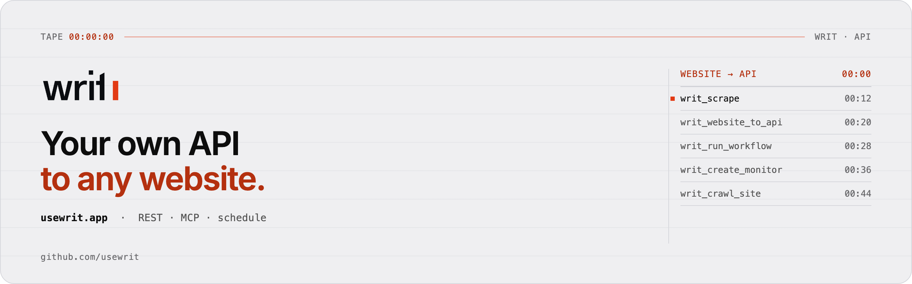

<a href="https://usewrit.app"><picture>
  <source media="(prefers-color-scheme: dark)" srcset="./assets/cover-dark.png">
  
</picture></a>

## Writ: your own API to any website

**[Writ](https://usewrit.app)** turns a website into an API you can call from your code, your AI
assistant or a schedule. Describe what you need from a site; Writ builds the API, tests it, and signs
in as you when the site needs a login. Each call goes straight to the site's own data requests,
without a browser, wherever the site allows it.

Writ is a cloud service first:

- **Writ Cloud** ([usewrit.app](https://usewrit.app)) runs your APIs on Writ's servers and reads the
  web at scale: Scrape a page to Markdown or HTML, Map a site, Harvest a whole site into a dataset,
  with residential connections and CAPTCHA solving when a site needs them. Call it over REST at
  `api.usewrit.app` or from any MCP client at `https://api.usewrit.app/mcp`.
- **Writ Desktop** is an optional free app that runs the same APIs on your own computer, over your
  own connection.

## Repositories

| | |
|---|---|
| **[writ-desktop](https://github.com/usewrit/writ-desktop)** | Writ Desktop downloads and issue tracker. The app itself is proprietary. |
| **[writ-plugins](https://github.com/usewrit/writ-plugins)** | The Writ plugin for Claude, Codex, Cursor, Gemini CLI and GitHub Copilot: the Writ Cloud MCP server plus skills. |
| **[writ-sdks](https://github.com/usewrit/writ-sdks)** | Client SDKs for TypeScript, Python, Go and Rust, for Writ Cloud and Writ Desktop. |
| **[writ-mcp](https://github.com/usewrit/writ-mcp)** | The MCP bridge: connect any MCP client to Writ Cloud with an API key. |
| **[writ-agent](https://github.com/usewrit/writ-agent)** | Connect a computer or server you control to your Writ account. |
| **[writ-for-websites](https://github.com/usewrit/writ-for-websites)** | Run the workflows your website ships on each visitor's own computer, with signed receipts. |

## Start here

- **[Documentation](https://usewrit.app/docs/)**: build an API, call it, connect an assistant
- **[Ready-made APIs](https://usewrit.app/marketplace/)**: tested APIs for popular sites
- **[Writ vs Firecrawl](https://usewrit.app/vs/firecrawl/)**: how a browserless API compares with a page reader
- **[Security](https://usewrit.app/security/)**: how sign-ins and data are handled, and how to report an issue

Maintained by **[Benjamin Garcia](https://github.com/benjamingarciaMTL)**. Issues and pull requests are welcome on any repository above.
